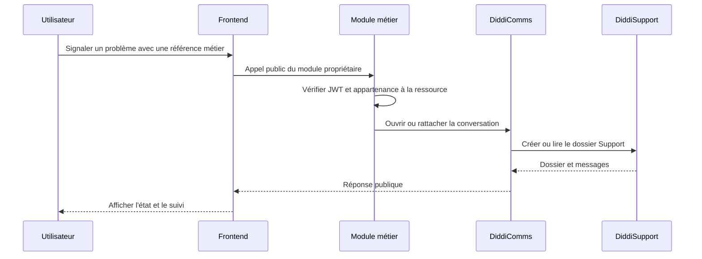
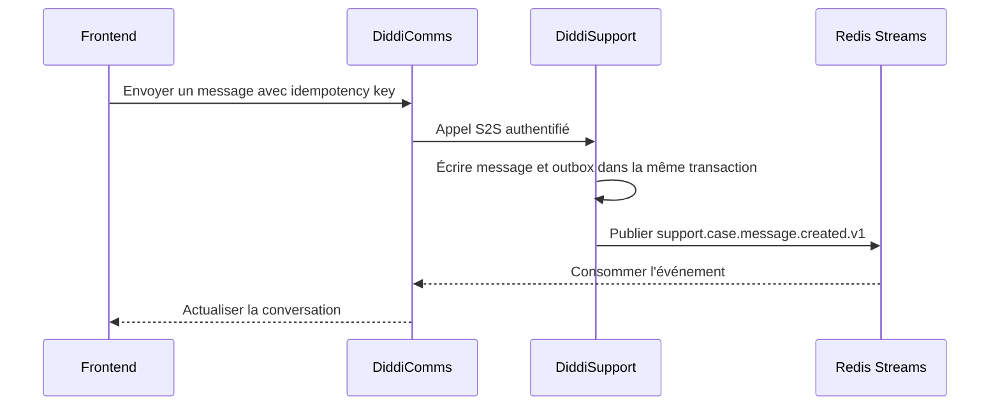

# Guide frontend — Support et signalements intermodules

**Version :** `frontend-support-flow.v1`
**Date :** 27 octobre 2026
**Périmètre :** DiddiGo, DiddiSend, DiddiFood, DiddiComms et DiddiSupport

Ce guide décrit les parcours frontend pour signaler un problème, ouvrir une
conversation et suivre un dossier Support. Il s'adresse aux équipes frontend
et précise les frontières entre les modules métier, DiddiComms et DiddiSupport.

## 1. Règle générale

Le frontend ne parle jamais directement aux routes internes de DiddiSupport ni
aux routes de contexte métier.

```text
Frontend
   |
   +--> API publique du module métier (si le problème est métier)
   |
   +--> façade publique DiddiComms (conversation et support)
                  |
                  +--> DiddiSupport (dossier, messages, audit)
                  |
                  +--> module propriétaire (contexte métier limité)
```

Le frontend envoie uniquement l'information saisie par l'utilisateur et la
référence visible dans l'écran. Il ne choisit jamais `user_id`, le rôle,
`origin_service`, les permissions ou le contenu d'une route `/internal/`.
Le backend déduit l'identité depuis le JWT DiddiFreeID et vérifie l'accès réel à
la ressource.



## 2. Choisir le bon parcours

| Situation | Action frontend | Propriétaire initial |
| --- | --- | --- |
| Danger immédiat pendant une course | Bouton SOS dédié | DiddiGo |
| Problème lié à une course | Signalement contextuel | DiddiGo, puis DiddiSupport |
| Problème lié à une livraison | Réclamation livraison ou support | DiddiSend, puis DiddiSupport |
| Problème lié à une commande Food | Support contextuel | DiddiFood, puis DiddiSupport |
| Demande générale d'aide | Ouvrir une conversation Support | DiddiComms/DiddiSupport |
| Paiement, retrait ou remboursement | Support avec référence métier | DiddiPay ou module propriétaire |

Un litige ordinaire ne doit jamais utiliser le bouton SOS.

## 3. DiddiGo — passager et chauffeur

### SOS

Le SOS est un parcours DiddiGo séparé du support ordinaire :

```http
POST /v1/rides/{ride_id}/emergency
Authorization: Bearer <user-jwt>
```

Le bouton doit être visible uniquement pour une course accessible à l'utilisateur
et demander une confirmation explicite. Le frontend attend une réponse positive
du backend avant d'afficher que l'alerte est enregistrée.

### Signaler un problème de course

Le bouton `Signaler un problème` doit apparaître dans le détail d'une course,
active ou terminée. Le modèle local peut être :

```json
{
  "category": "payment_issue",
  "message": "Le paiement est affiché comme échoué.",
  "attachments": []
}
```

Le frontend ne transmet pas le rôle passager/chauffeur : DiddiGo le déduit de
la course et du JWT.

À la date de ce guide, la route publique de création de dossier Support côté
DiddiGo n'est pas encore publiée. Le frontend ne doit donc pas inventer une
route comme `POST /v1/rides/{ride_id}/support-reports`.

### Contexte réservé aux services

DiddiSupport peut demander le contexte minimal de la course à DiddiGo :

```http
GET /internal/v1/support/ride/{ride_id}/context
```

Cette route est S2S uniquement. Elle renvoie notamment le statut, le montant,
la méthode de paiement, les participants identifiés par UUID et la chronologie.
Les téléphones, positions, adresses, KYC/KYV et détails fournisseur de paiement
sont masqués.

## 4. DiddiSend — client et coursier

DiddiSend reste propriétaire de la livraison. Le frontend utilise son OpenAPI
pour lire la livraison et ses états.

Pour une livraison terminée avec état autorisé, DiddiSend expose une réclamation
métier :

```http
POST /v1/deliveries/{delivery_id}/complaints
Authorization: Bearer <user-jwt>
```

Le backend DiddiSend vérifie que l'appelant est bien le client concerné et
qu'une seule réclamation existe pour la livraison. Le frontend doit afficher
l'erreur métier si la livraison n'est pas éligible ou si une réclamation existe
déjà.

Pour une conversation support générale ou un suivi agent, le frontend passe par
la façade DiddiComms. Le contexte interne DiddiSend est réservé à DiddiSupport :

```http
GET /internal/v1/support/delivery/{delivery_id}/context
```

Le contexte peut contenir le statut, le mode de livraison, les montants, la
devise, le paiement, les participants et la chronologie. Les téléphones,
adresses, coordonnées, PIN et détails du prestataire de paiement ne sont pas
exposés.

## 5. DiddiFood — client et restaurant

DiddiFood reste propriétaire de la commande. Pour une demande liée à une
commande, le frontend affiche l'identifiant de commande dans l'écran, mais ne
transmet pas lui-même les données client, adresse ou paiement.

Le contexte réservé à DiddiSupport est :

```http
GET /internal/v1/support/order/{order_id}/context
```

La réponse suit `diddi.context.v1` et peut fournir le statut de commande, le
total, l'état de livraison et les informations restaurant nécessaires au
traitement. Les identifiants client, adresse de livraison, coordonnées et
références sensibles de paiement sont exclus.

Le dépôt DiddiFood inspecté ne publie pas de route frontend universelle de
création de dossier Support. Pour une discussion avec un agent, utiliser la
façade DiddiComms dès que son contrat public est publié ; ne pas appeler la
route interne depuis l'application.

## 6. Demande générale d'aide

Depuis le menu `Aide et support`, le frontend ouvre une conversation sans
ressource métier obligatoire. Le transport public attendu est DiddiComms, qui
créera ou retrouvera le dossier DiddiSupport.

Le formulaire doit contenir au minimum :

```json
{
  "category": "account_help",
  "message": "Je ne peux pas utiliser mon compte.",
  "attachments": []
}
```

Le frontend ne doit pas fournir `origin_service` pour une demande générale.
Le backend doit déterminer l'origine autorisée ou appliquer une politique
explicite pour les dossiers sans ressource métier.

## 7. Messages et conversation

Le frontend ne publie pas directement dans Redis et ne connaît pas
`diddisupport.events`.



Pour un message utilisateur :

1. le frontend envoie le message à DiddiComms ;
2. DiddiComms vérifie l'identité et l'accès au dossier ;
3. DiddiComms appelle DiddiSupport avec son JWT de service ;
4. DiddiSupport enregistre le message et publie l'événement ;
5. DiddiComms consomme l'événement et actualise la conversation/notification.

Utiliser une clé d'idempotence stable pour toute création ou envoi rejouable.
Après une reconnexion, refaire une lecture REST du dossier et des messages ; le
temps réel ne remplace jamais la synchronisation REST.

## 8. Erreurs frontend

| Situation | Comportement |
| --- | --- |
| `401` | renouveler le JWT ou demander une reconnexion |
| `403` | masquer l'action non autorisée et afficher un message clair |
| `404` | ressource supprimée ou inconnue, proposer de revenir à la liste |
| `409` | afficher l'état déjà créé ou déjà soumis |
| `422` | corriger les champs du formulaire |
| `429` | respecter le délai de retry retourné |
| `503` | afficher indisponibilité temporaire et proposer de réessayer |

Afficher le `code` métier et le `request_id` dans les outils de diagnostic, mais
jamais une stack trace ni un secret.

## 9. Interdictions

- Ne jamais appeler une route `/internal/` depuis le frontend.
- Ne jamais appeler directement DiddiSupport avec un JWT utilisateur tant que
  la façade publique n'est pas officiellement publiée.
- Ne jamais mettre de secret S2S, token Redis ou clé d'API dans l'application
  mobile/web.
- Ne jamais copier dans un formulaire les détails déjà connus par le backend.
- Ne jamais déduire qu'une course, commande ou livraison appartient à
  l'utilisateur uniquement à partir d'un identifiant affiché.
- Ne jamais confondre SOS, réclamation métier et conversation Support.

## 10. Checklist d'implémentation frontend

- [ ] Le bouton SOS est séparé du bouton Support.
- [ ] Le backend vérifie l'appartenance à la ressource.
- [ ] Le formulaire envoie une catégorie, un message et des pièces jointes
      optionnelles, sans `user_id` ni rôle choisi par le client.
- [ ] Les routes publiques sont prises dans l'OpenAPI déployé.
- [ ] Aucune route `/internal/` n'est appelée par le frontend.
- [ ] Les clés d'idempotence sont conservées lors des retries.
- [ ] Les erreurs métier et `request_id` sont affichés proprement.
- [ ] Après reconnexion, les dossiers et messages sont relus via REST.
- [ ] Les données sensibles sont masquées côté backend et non copiées dans le
      formulaire.

## Sources inspectées

- DiddiGo : `DIDDIGO_FRONTEND_SUPPORT_BRIEF_2026-10-27.md`,
  `docs/integrations/diddisupport.md` et le routeur de contexte course.
- DiddiSend : `docs/integrations/diddisupport.md`, le brief frontend et le
  routeur de réclamation livraison.
- DiddiFood : `docs/guides/support-context-flow.md`, le routeur de contexte
  commande et les tests de contrat Support.
- DiddiSupport : `DIDDI_MODULE_PROTOCOL_V1.md` et
  `manifests/diddi-support.v1.json`.
